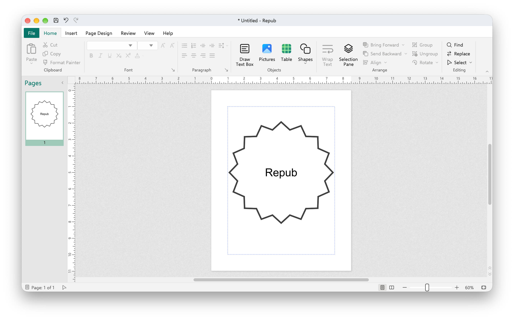

# Repub

> [!WARNING]
> Repub is in early development and may corrupt .pub files it is recommended to 
> keep a copy of your .pub files and save as a .repub when doing edits.

Repub is an open-source cross-platform alternative for Microsoft Publisher.



- Desktop GUI for Windows, macOS, and Linux
- WebAssembly build
- Command-line interface for automation and scripting
- Model Context Protocol (MCP) server for AI assistants
- GPU rendering with a CPU rasterizer
- Imports Publisher (`.pub`) files; exports PDF, SVG, HTML, and images

## Build

Requires Rust 1.75 or later.

```bash
git clone git@github.com:lukem570/repub.git
cd repub
cargo build --workspace
cargo test --workspace
```

Run the desktop app:

```bash
cargo run --release -p repub
```

Use the command-line interface:

```bash
cargo run --release -p repub-cli -- new --size letter mydoc.repub
cargo run --release -p repub-cli -- export mydoc.repub mydoc.pdf
```

## License

Licensed under either of

- Apache License, Version 2.0 ([LICENSE-APACHE](LICENSE-APACHE))
- MIT License ([LICENSE-MIT](LICENSE-MIT))

at your option.
